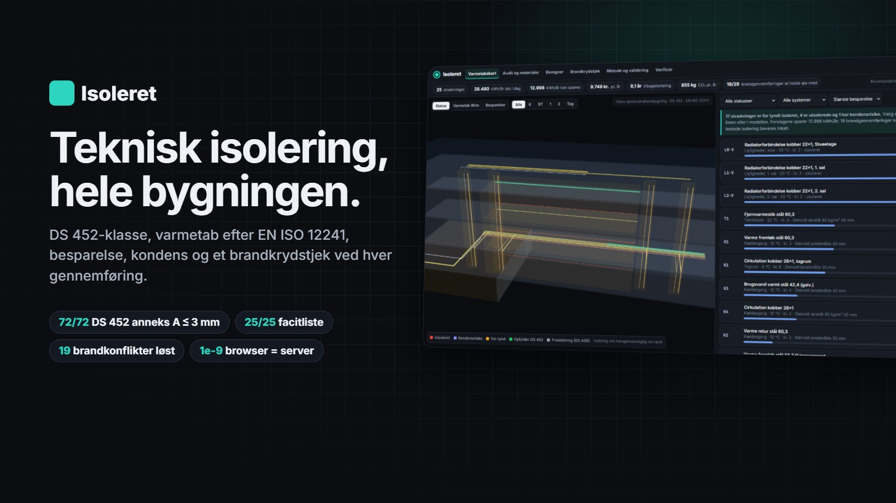
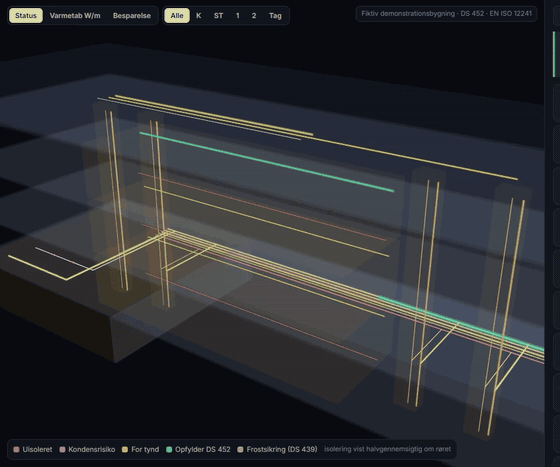
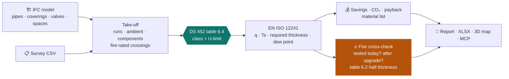

<div align="center">



# Isoleret

### Every pipe in the building against DS 452, and against the fire seals it passes through.

**[▶ Open the app](https://abdullah13793-commits.github.io/isoleret/app/)** · **[Project page + tour](https://abdullah13793-commits.github.io/isoleret/)** · **[Verify a file](https://abdullah13793-commits.github.io/isoleret/app/verify.html)**

[](https://github.com/abdullah13793-commits/isoleret/actions/workflows/tests.yml)
      



</div>

Isoleret audits the technical insulation of a whole building from an **IFC model** or a **survey CSV**. Every run gets:

- its **DS 452 class** from table 6.4
- **heat loss** after EN ISO 12241 (λ at the layer's mean temperature, convection plus radiation at the surface)
- the **missing thickness** and **condensation risk**
- **savings, CO₂, cost and payback**
- a **material list**

Every fire-rated crossing is also checked against the tested penetration-seal configurations (ETA-21/0110, ETA-20/1322), before and after
the proposed upgrade.



## Energy meets fire
A penetration seal is only classified with the insulation it was tested with. Make the insulation thicker, or change its type or brand, and
a tested seal can become a deviation. In the demo building, 19 of 29 fire-rated crossings would become deviations after a straight upgrade.
All 19 are resolved with DS 452 table 6.2, which needs only half the class thickness in a penetration: keep the tested insulation
(e.g. ETA-21/0110 A.4.4.1, 30 mm stone wool over 1000 mm) and upgrade outside it.

## Validation (independent references)
| Reference | Cells | Result |
|---|---|---|
| DS 452 Annex A, tables A.1/A.2 (60/20 °C, Ø18-60, classes 1-6) | 72 | RMS 0.76 mm, max 2.4 mm; one design λ = 0.0459 W/mK fitted and stated, because the standard does not print it |
| Energistyrelsen, Energihåndbogen 2019, tables 11/12/15/16 | 96 | bare-pipe savings within 1.7 %; insulated rows within 3.3 kWh on average (λ 0.038 as stated) |
| Finding | | The basement tables say half the loss is useful heat; the published numbers reproduce only **without** that rule |

Cell-by-cell CSVs are on the [verify page](https://abdullah13793-commits.github.io/isoleret/app/verify.html); charts are on [Metode](https://abdullah13793-commits.github.io/isoleret/app/metode.html).

## Verifiable by design
- **Every number:** "Vis beregning" on each run lists every step (λ, R per layer, h_cv, h_r, R_se, q, U against the limit). Each one lands on
  the report's value ✓, and the PDF appendix has the same steps.
- **Every file:** SHA-256 manifest; drag a file onto [Verificér](https://abdullah13793-commits.github.io/isoleret/app/verify.html) (hashed
  in the browser, never uploaded).
- **The method:** `python -m isoleret.reproduce` re-runs validation and audit from the source model (6/6). Details: [`docs/VERIFY.md`](docs/VERIFY.md).

## Demo results (fictitious Blok C: 25 runs, 425 m, 14 components)
17 runs too thin, 4 uninsulated, 1 condensation risk, 1 frost protection (DS 439), 2 compliant. The proposal saves 12,998 of 28,480 kWh/yr:
9,749 DKK/yr, 855 kg CO₂/yr, 78,520 DKK, a simple payback of 8.1 years at example prices. **14 tests** pass, including browser/Python parity to
1e-9, a survey round trip and the MCP server end to end.

## Run it
```bash
pip install -r requirements.txt && python -m playwright install chromium
cd src
python -m isoleret.validate && python -m isoleret.audit && python -m isoleret.report
python -m isoleret.export_web && python -m isoleret.manifest && python -m isoleret.reproduce
cd .. && python -m pytest tests
```
MCP client config: `{"mcpServers": {"isoleret": {"command": "python", "args": ["<repo>/src/mcp_server.py"]}}}`

More: [SPEC](SPEC.md) · [Positioning](docs/POSITIONING.md) · [Verification](docs/VERIFY.md) · Companion product: [**Gennemført 2.0**, penetration seals](https://github.com/abdullah13793-commits/gennemfoert)

> Decision support. λ curves are typical class values (replace them with the product's data sheet); prices and CO₂ factors are examples; the demo
> building is fictitious; a deviation at a fire seal needs a brandteknisk vurdering by a person. MIT licence.
